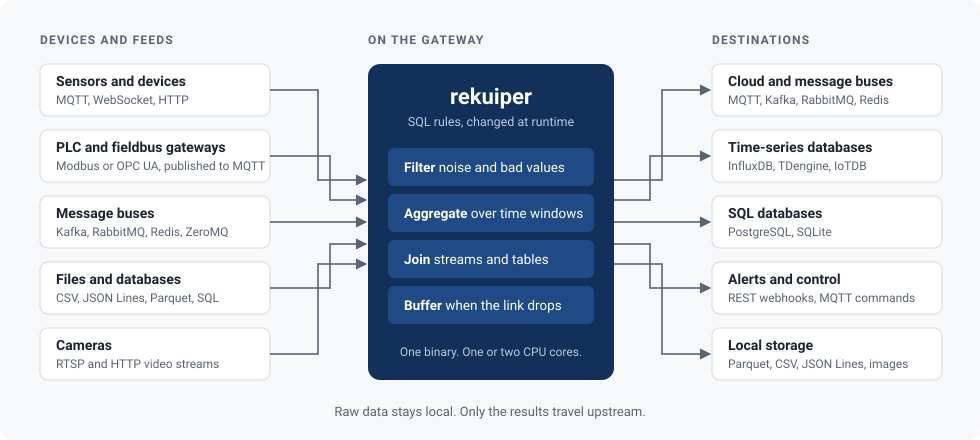
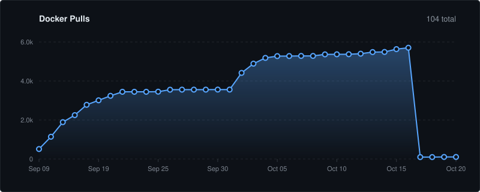

# rekuiper

**Process device data where it is produced.**

rekuiper is a small SQL engine that sits between your devices and your cloud. It filters, aggregates, and routes live data on the gateway itself, so you send upstream only what matters.

[](https://github.com/Indus-Stack/rekuiper/releases)
[](https://github.com/Indus-Stack/rekuiper/actions/workflows/ci.yml)
[](LICENSE)
[](https://hub.docker.com/r/indusstack/rekuiper)

[Documentation](https://rekuiper.indramqtt.com) · [Run the demo](#try-it-in-60-seconds) · [Is it a fit?](#is-it-a-fit) · [Coming from eKuiper?](#coming-from-ekuiper)

---

## Where it fits



You write a rule in SQL. rekuiper runs it on every message as the message arrives. You add, change, and remove rules through a REST API while the engine runs.

What changes when you put it in the path:

- **You send less data.** One summary row per minute replaces sixty raw readings.
- **You decide locally.** An alert fires on the gateway in milliseconds, without a cloud round trip.
- **You lose nothing when the link drops.** Results wait in memory and on disk, then go out in order when the link returns.

---

## Try it in 60 seconds

This demo needs only Docker. A built-in simulator makes the data.

**1. Start the engine.**

```bash
docker run -d --name rekuiper -p 9081:9081 indusstack/rekuiper:1.0.0-rc4
```

**2. Register simulated sensor readings, ten per second.**

```bash
curl -X PUT http://localhost:9081/metadata/sources/simulator/confKeys/demo \
  -H "Content-Type: application/json" \
  -d '{
    "data": [
      {"deviceId": "pump-1", "temperature": 21.5},
      {"deviceId": "pump-1", "temperature": 23.0},
      {"deviceId": "pump-1", "temperature": 24.5}
    ],
    "interval": 100,
    "loop": true
  }'
```

**3. Create a stream that reads them.**

```bash
curl -X POST http://localhost:9081/streams \
  -H "Content-Type: application/json" \
  -d '{"sql": "CREATE STREAM demo () WITH (TYPE=\"simulator\", CONF_KEY=\"demo\")"}'
```

**4. Add a rule that turns every five seconds of readings into one row.**

```bash
curl -X POST http://localhost:9081/rules \
  -H "Content-Type: application/json" \
  -d '{
    "id": "five_second_summary",
    "sql": "SELECT count(*) AS readings, avg(temperature) AS avg_temp FROM demo GROUP BY TUMBLINGWINDOW(ss, 5)",
    "actions": [{ "log": {} }]
  }'
```

**5. Watch the result.**

```bash
docker logs -f rekuiper
```

```text
[RULE five_second_summary] Matched record: {"readings": Number(49), "avg_temp": Number(23.03)}
```

About fifty readings go in. One row comes out. To send that row to MQTT, Kafka, or a database, replace `log` with another action.

Next: [Getting Started Guide](docs/en_US/getting_started/getting_started.md)

---

## Common patterns

Each pattern is one or two SQL rules.

| Pattern | The situation | What the rule does |
| :--- | :--- | :--- |
| **Cut the cloud bill** | Devices publish every second. The cloud needs one row per minute. | Aggregates over a [time window](docs/en_US/concepts/streaming/windowing.md) and sends the summary. |
| **Alert locally** | A reading crosses a limit and someone must know now. | Filters with `WHERE` and calls a webhook or publishes an MQTT command. |
| **Survive a bad link** | The uplink drops for minutes or hours. | The [sink cache](docs/en_US/guide/sinks/overview.md) stores results and resends them in order. |
| **One feed, many destinations** | The same data must go to storage, to a dashboard, and to an alert topic. | Several rules read one stream. Each rule has its own destinations. |
| **Enrich before sending** | Messages carry a device ID. The cloud needs the site and the asset name. | Joins the stream with a [lookup table](docs/en_US/guide/tables/lookup.md) in Redis or SQL. |

Example for the first pattern:

```sql
SELECT deviceId, avg(temperature) AS avg_temp, max(temperature) AS max_temp
FROM sensors
GROUP BY deviceId, TUMBLINGWINDOW(ss, 60)
```

---

## Is it a fit?

| Use rekuiper when | Look elsewhere when |
| :--- | :--- |
| Your data arrives via MQTT, HTTP, WebSocket, Kafka, AMQP, OTLP, Modbus TCP/RTU, or OPC-UA. | You need legacy proprietary fieldbus drivers (such as BACnet or Profibus). Put a protocol gateway in front and publish to MQTT. |
| You want the logic in SQL, and you want to change it at runtime. | You need a visual flow builder for people who do not write SQL. |
| The machine has one or two CPU cores and limited memory. | You need a distributed cluster that scales across many nodes. rekuiper runs on one node. |
| You need time windows, joins, and rules that keep state. | You only need to collect metrics and forward them without processing. |

---

## Measured on one CPU core

All tests run in a container limited to one CPU core and 1 GiB of RAM.

| Measure | Result | Tested on |
| :--- | :--- | :--- |
| End-to-end streaming SQL throughput | 1,085,885 events per second (460 ms for 500k records) | 1.0.0-rc4 |
| Zero-parse in-process SQL pipeline | 2,207,367 events per second (226 ms for 500k records) | 1.0.0-rc4 |
| Parallel rules on one stream | 1,000 rules, 500,000 evaluations per second | 0.505 |
| MQTT throughput, single rule | 150,000 to 200,000 messages per second | 0.500 |
| Heap memory under load | 4.4 to 10.2 MiB | 0.500 |
| Footprint | One static binary, about 30 MB | 1.0.0-rc4 |

Full method, hardware limits, and comparisons with eKuiper, Telegraf, and Redpanda Connect: [Benchmark Overview](docs/en_US/benchmarks/overview.md).

---

## Connectors

| | Sources (data in) | Sinks (data out) |
| :--- | :--- | :--- |
| **Messaging** | MQTT, Kafka, RabbitMQ, Redis, ZeroMQ, WebSocket | MQTT, Kafka, RabbitMQ, Redis, ZeroMQ, WebSocket |
| **HTTP** | HTTP pull, HTTP push | REST |
| **Databases** | PostgreSQL, SQLite | PostgreSQL, SQLite, InfluxDB v1 and v2, TDengine, IoTDB |
| **Files and media** | CSV, JSON Lines, Parquet, video (FFmpeg) | CSV, JSON Lines, Parquet, image |
| **Industrial** | Modbus TCP/RTU, OPC-UA (`opc.tcp`), EdgeX Foundry, Neuron | Modbus TCP/RTU, OPC-UA (`opc.tcp`), EdgeX Foundry, Neuron |
| **Observability** | OpenTelemetry (OTLP/HTTP metrics, logs, traces) | OpenTelemetry (OTLP/HTTP export) |
| **Test** | Simulator, Memory | Log, Memory, Nop |

Details: [Sources](docs/en_US/guide/sources/overview.md) · [Sinks](docs/en_US/guide/sinks/overview.md)

---

## What else is in the box

- **Stream SQL.** Tumbling, hopping, sliding, count, and session windows. Stream-to-stream, stream-to-table, and temporal `ASOF JOIN` / `LEFT ASOF JOIN`. A rich library of **221 built-in functions** (including DFA CEP `sequence_match`/`sequence_count`, CompactDdSketch percentiles, Welford variance, and vector math). See the [SQL Reference](docs/en_US/sqls/overview.md).
- **High-Throughput Zero-Clone Engine.** Zero-clone borrowed WHERE comparisons, register-level arithmetic evaluation (`try_eval_numeric_fast`), and reference-counted `SharedMap` CoW across rules.
- **Rete-Lite StreamBus Routing.** Single-subscriber lock-free channel fast-paths and multi-rule indexable predicate routing.
- **Parquet Columnar Buffering.** Automatic batch buffering with Arrow RecordBatch output and internal metadata isolation.
- **Bounded memory.** Queues between sources, rules, and sinks have fixed sizes. A slow destination slows the source; it does not fill the memory.
- **Declarative GitOps & Dead-Letter Queues (DLQ).** Run in read-only GitOps mode (`--declarative`) with automatic file watching, and isolate poison-pill records across 5 pipeline stages (`GET/DELETE /rules/:id/errors`).
- **Extensions.** Write SQL functions as sandboxed WebAssembly modules.
- **Secrets.** Read credentials from HashiCorp Vault or environment variables.
- **Operations & Fleet Management.** Prometheus metrics, a self-contained Web UI (`GET /ui`), an interactive terminal dashboard (`rekuiper top`), a Helm chart, a `rekuiper` / `kuiper` CLI, a centralized Fleet Control Plane with staged canary rollouts, and the Visual Stream DAG Studio with real-time wire-tap telemetry.
- **AI tooling.** A Model Context Protocol (MCP) server (`rekuiper-mcp`) exposing **57 tools** (including `explain_pipeline_profile`, fleet rollouts, and visual DAG inspection), 25 live resources, and 12 prompt workflows. See [MCP](docs/en_US/mcp/overview.md).

---

## Coming from eKuiper?

rekuiper implements the eKuiper REST API, SQL dialect, rule format, and `kuiper` CLI. Your streams, rules, and integration pipelines work without changes.

- [Compatibility notes](docs/en_US/concepts/ekuiper_compatibility.md)
- [Migration guide](docs/en_US/operation/migration.md)
- [How releases are qualified against eKuiper](docs/en_US/reliability/qualification_and_scope.md)

---

## Install

| Method | Command or link |
| :--- | :--- |
| Docker | `docker run -d -p 9081:9081 indusstack/rekuiper:1.0.0-rc4` |
| Docker Compose | `docker compose -f deploy/docker/docker-compose.yml up -d` |
| Kubernetes | `helm install rekuiper deploy/chart/rekuiper` ([chart docs](deploy/chart/rekuiper/README.md)) |
| Binaries | [Releases](https://github.com/Indus-Stack/rekuiper/releases) |
| Source | `cargo build --release -p kuiperd` |

The Docker image listens on all interfaces. A binary that you run directly listens on `127.0.0.1` by default. Ports, TLS, and authentication: [Installation and Deployment](docs/en_US/installation.md).

---

[](https://hub.docker.com/r/indusstack/rekuiper)

---

## Project

- [Changelog](CHANGELOG.md)
- [Contributing](docs/en_US/CONTRIBUTING.md)
- License: MIT or Apache-2.0, at your option. See [LICENSE](LICENSE).
