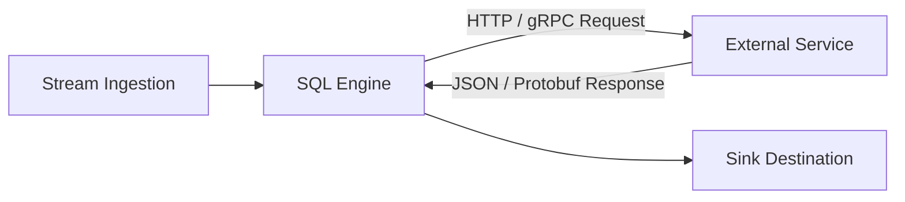

# External Services and Functions

rekuiper can map external microservices and remote endpoints to SQL functions. When a streaming rule executes an external function, rekuiper marshals incoming SQL arguments, invokes the target service endpoint over HTTP REST or gRPC, and maps the response back into the streaming pipeline.

---

## Machine Learning & AI Inference Note

> [!TIP]
> **AI/ML Model Inference (ONNX, PyTorch, TensorFlow)**:
> rekuiper is implemented in Rust and does not bundle heavy Python/C++ deep-learning runtimes inside the streaming engine binary. To execute machine learning inference (such as ONNX Runtime, PyTorch, or TensorFlow Lite models), deploy your model behind a lightweight HTTP REST microservice (using FastAPI, Triton Inference Server, or TorchServe) and invoke it using external functions, or compile lightweight deterministic inference logic into a sandboxed [WebAssembly UDF](../wasm/overview.md).

---

## Architecture

External functions in rekuiper operate across two paradigms:
- **HTTP REST Services**: Best for webhooks, microservices, and AI inference APIs.
- **gRPC Services with Protobuf**: Best for high-throughput, strongly typed RPC invocations with low serialization overhead.



---

## Configuration

External function configurations are stored under `etc/services` or registered dynamically. A service definition consists of a JSON metadata file and an optional Protobuf schema file.

### 1. HTTP REST Service Configuration

Create `etc/services/weather_service.json`:

```json
{
  "about": {
    "author": {
      "name": "Edge Operations Team"
    },
    "description": {
      "en_US": "Remote weather forecast and temperature lookup service"
    }
  },
  "interfaces": {
    "weather": {
      "address": "http://weather-service.local:8080",
      "protocol": "rest",
      "functions": [
        {
          "name": "get_temperature",
          "serviceName": "temperature"
        }
      ],
      "options": {
        "headers": {
          "Content-Type": "application/json",
          "User-Agent": "rekuiper-stream-engine"
        },
        "insecureSkipVerify": false
      }
    }
  }
}
```

### 2. Schema-Based gRPC Configuration

For high-throughput gRPC services, provide a `.proto` schema and a service mapping file:

Create `etc/services/schemas/detector.proto`:

```protobuf
syntax = "proto3";

package defect;

message DetectRequest {
  string device_id = 1;
  repeated float sensor_readings = 2;
}

message DetectResponse {
  bool is_anomaly = 1;
  float confidence = 2;
}

service DefectDetector {
  rpc CheckAnomaly (DetectRequest) returns (DetectResponse);
}
```

Create `etc/services/defect_service.json`:

```json
{
  "about": {
    "description": {
      "en_US": "Edge anomaly detector service"
    }
  },
  "interfaces": {
    "detector": {
      "address": "tcp://127.0.0.1:50051",
      "protocol": "grpc",
      "schemaType": "protobuf",
      "schemaFile": "detector.proto",
      "functions": [
        {
          "name": "detect_anomaly",
          "serviceName": "CheckAnomaly"
        }
      ]
    }
  }
}
```

---

## Invoking External Functions in SQL Rules

Once configured, the external function is invoked identically to any built-in SQL function:

### Example: REST Model Inference

```sql
SELECT
  deviceId,
  temperature,
  get_temperature(locationId)->temp_celsius AS expected_temp
FROM
  sensor_stream
WHERE
  temperature > get_temperature(locationId)->threshold;
```

### Example: gRPC Defect Detection

```sql
SELECT
  deviceId,
  detect_anomaly(deviceId, readings)->is_anomaly AS anomaly_flag,
  detect_anomaly(deviceId, readings)->confidence AS confidence_score
FROM
  equipment_telemetry
WHERE
  detect_anomaly(deviceId, readings)->is_anomaly = true;
```

---

## Best Practices for Edge Performance

1. **Keep Latency Low**: Ensure external microservices run on the same local network or edge gateway host to avoid high latency per streaming row.
2. **Batch / Filter First**: Use SQL `WHERE` clauses to filter out irrelevant rows before invoking external HTTP functions.
3. **Use WebAssembly for Pure Algorithms**: If your function does not require external network I/O or specialized hardware acceleration, compile it to [WebAssembly](../wasm/overview.md) to run directly in-process with zero network overhead.
