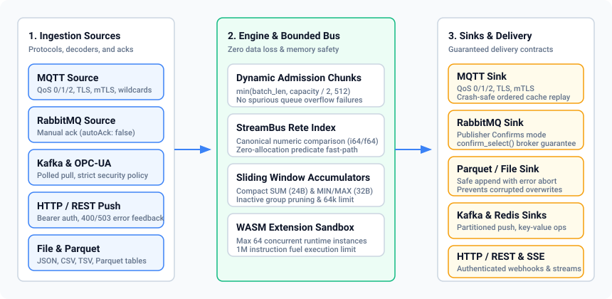

# Connector Support Matrix and Delivery Contracts

This document specifies the supported connectors in **rekuiper**, their functional roles, payload formats, authentication mechanisms, and delivery guarantees.

## 1. Connector Capabilities Matrix

The table below details all integrated protocol connectors:

| Connector | Role | Formats Supported | Auth & Transport Security | Delivery Guarantee | State Bounding & Resilience | Status |
| :--- | :--- | :--- | :--- | :--- | :--- | :--- |
| **MQTT** | Source & Sink | JSON, Protobuf, Binary, Custom | Anonymous, Username/Password, TLS 1.3, mTLS (Rustls) | QoS 0 (at-most-once), QoS 1 (at-least-once), QoS 2 | Crash-safe disk replay cache (`sink_cache`), ordered backpressure | Production Verified |
| **RabbitMQ** | Source & Sink | JSON, Protobuf, Binary | AMQP 0-9-1 credentials, dynamic secrets (`vault://`, `env://`) | At-least-once via manual ack (`autoAck: false`), publisher confirms (`confirm_select`) | Bounded consumer prefetch QoS, dead-letter reject | Production Verified |
| **Kafka** | Source & Sink | JSON, Binary | Anonymous, Plain TCP (SASL/TLS planned) | In-memory partition offset, at-least-once (group ID informational) | Bounded channel buffer | Beta (Roadmap) |
| **OPC-UA** | Source | Binary, Nodes snapshot | Anonymous, Endpoint URL; strict security policy validation | Polled subscription intervals | Rejects unsupported encryption policies upfront | Production Verified |
| **HTTP / REST** | Source & Sink | JSON, Text | Bearer token (`REKUIPER_TOKEN`), Basic auth | Synchronous HTTP status feedback (400 on bad data, 503 on engine saturation) | Dynamic batch chunk reservation, backpressure propagation | Production Verified |
| **SSE (Ruletest)** | Source (Stream) | JSON Event Stream | Bearer token authentication guard (`Authorization: Bearer <token>`) | Real-time event streaming | Bounded channel buffer with client disconnect detection | Production Verified |
| **Parquet** | Source & Sink | Apache Parquet (Columnar) | Local filesystem, ext4, NTFS permissions | Atomic write, fail-closed on corrupt files | Rejects append to unreadable files without data overwrite | Production Verified |
| **File (Flat)** | Source & Sink | JSON, CSV, TSV, Lines | Local filesystem permissions | Append / replace modes | File rotation, rolling size limits | Production Verified |
| **Redis** | Source & Sink | Key-Value, JSON | Redis password, TLS URL (`rediss://`) | Read-after-write consistency, pub/sub | Memory TTL expiration, bounded pool | Production Verified |
| **Memory** | Source & Sink | Internal Records (`StreamRecord`) | Internal process isolation | Zero-copy channel delivery | Bounded queues (no memory leak) | Production Verified |
| **WASM (UDF)** | Extension Engine | WebAssembly Bytecode | In-process WebAssembly sandbox | Deterministic function evaluation | Max 64 concurrent instances, 1,000,000 instruction fuel limit | Production Verified |

---

## 2. Ingestion Delivery Contracts

### 2.1 MQTT Ingestion

The MQTT source operates over `rumqttc`:
1. Subscribes to single or wildcard topics (`+`, `#`).
2. Dispatches incoming packets to the internal `StreamBus`.
3. Handles disconnections and reconnects automatically with exponential backoff.
4. Clamps connection keep-alive values to a minimum of 5 seconds to prevent broker timeout churn.

### 2.2 RabbitMQ Ingestion

The RabbitMQ source connects via AMQP 0-9-1:
1. **Manual Acknowledgments (`autoAck: false`)**: The consumer does not acknowledge messages at receipt. It sends `delivery.ack()` only after all records in the delivery successfully enter the engine stream bus.
2. **Re-queue on Engine Saturation**: If the stream bus closes or pipeline shutdown occurs before admission, the consumer calls `delivery.nack(requeue: true)`. The broker delivers the message to another consumer or retains it.
3. **Poison Message Rejection**: If message decoding fails due to corrupt payload format, the consumer calls `delivery.reject(requeue: false)` to prevent infinite crash loops.

### 2.3 Dynamic Batch Admission

All source connectors push records through the runtime batch admission coordinator:
- Large batches divide dynamically into chunks: `min(batch_len, capacity / 2, 512)`.
- If downstream rule queues are configured with small buffer limits (e.g., 50 slots), the engine adjusts chunk reservation automatically.
- Valid batches are never rejected due to static chunk size mismatches.
- Admission failures propagate HTTP 503 (Service Unavailable) status back to the client immediately.

### 2.4 Kafka Ingestion & Offset Notice

The Kafka connector operates in Beta status:
- Ingestion tracks partition offsets in memory during active rule processing.
- The `groupId` configuration setting is informational in the v1.0 engine.
- Broker-coordinated consumer group offset commits and SASL-PLAIN/SCRAM authentication modes are scheduled on the post-v1.0 delivery roadmap.

---

## 3. Sink Dispatch & Persistence Guarantees

### 3.1 RabbitMQ Publisher Confirms

The RabbitMQ sink enables publisher confirmations on channel setup:
- Calls `channel.confirm_select()` immediately upon channel creation.
- Awaits the broker `PublisherConfirm` confirmation response before returning success to the pipeline.
- If the broker rejects or drops a publish, the sink returns an explicit error to trigger retries or DLQ logging.

### 3.2 Crash-Safe Disk Replay Cache

When an external network destination is unavailable, sink connectors buffer records to disk:
1. Records write to sequential disk cache pages in the configured cache directory.
2. During cache replay, records stream from disk to memory while the disk file remains intact.
3. The cache page file deletes from disk **only after** all records in the page achieve verified delivery to the remote broker.
4. If a process crash or power loss occurs during replay, no unconfirmed records are lost.

### 3.3 Parquet Storage Safety

The Parquet storage writer enforces data integrity:
- Inspects existing Parquet archives before starting an append operation.
- If an existing file cannot be read or validated as a valid Parquet archive, the writer returns an immediate error.
- Corrupted files are never overwritten or replaced with incomplete batches.

---

## 4. Security and Client Authentication

All external network entry points enforce authentication parity:
- **REST and SSE Routers**: Require `Authorization: <jwt>` for standard RS256 JWT REST endpoints (or `Authorization: Bearer <token>` for Fleet/UI bearer endpoints) when authentication is enabled in server configuration.
- **CLI Client (`rekuiper-cli`)**: Supports `--token <token>` or `-t <token>` command-line arguments, as well as `REKUIPER_TOKEN` and `KUIPER_TOKEN` environment variables.
- **MCP Server (`rekuiper-mcp`)**: Supports `--token <token>` CLI arguments and auto-detects `REKUIPER_TOKEN` / `KUIPER_TOKEN` to access protected engine endpoints.
- **OPC-UA Connector**: Validates security policies during connection initialization and rejects unsupported non-None policies explicitly before establishing insecure channels.

