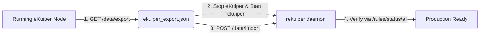

# Migration & Modernization Guide: Moving to rekuiper

This comprehensive guide details migration strategies, architectural patterns, and step-by-step procedures for transitioning legacy edge streaming workloads to **rekuiper**.

Whether migrating from **LF Edge eKuiper (Go)**, **InfluxData Telegraf**, **Node-RED**, or **Vector / Fluent Bit**, rekuiper delivers a single statically-linked, memory-efficient Rust runtime (<35 MB RAM) with zero garbage-collection pauses and sub-millisecond p99 latencies.

---

## Migration Matrix at a Glance

| Source Engine | Primary Migration Reason | Configuration Mapping | Rule / Logic Mapping | Migration Effort |
| :--- | :--- | :--- | :--- | :--- |
| **LF Edge eKuiper** | 10× memory reduction, zero GC jitter, 100% drop-in compatibility | Identical `kuiper.yaml` / REST API | 100% direct SQL & JSON reuse | **2 Minutes (Drop-in)** |
| **Telegraf** | Stateful windowing, joins, and edge-native SQL filtering | TOML `inputs/outputs` → rekuiper Streams/Sinks | `processors.regex` / `aggregators` → SQL `SELECT ... GROUP BY` | **Low (Direct SQL conversion)** |
| **Node-RED** | 90% memory reduction, thread-safe concurrency, headless CI/GitOps | Flow JSON → Declarative YAML / REST Rules | JavaScript `function` nodes → SQL expressions / JS UDFs | **Moderate (Flow to SQL)** |
| **Vector / Fluent Bit** | Temporal window aggregations, stateful joins, edge anomaly detection | Vector YAML / Fluent Conf → Source/Sink definitions | Vector VRL / Lua scripts → ANSI SQL queries | **Low–Moderate** |

---

## 1. Migrating from LF Edge eKuiper (Go)

`rekuiper` is engineered as an exact drop-in replacement for eKuiper. All REST API endpoints, CLI syntax, SQL grammar, window functions, and connector configurations remain 100% compatible.

### Why Migrate?
- **Footprint**: Idle memory decreases from ~120 MB to **<18 MB**; active high-load memory drops from ~350 MB to **<45 MB**.
- **Determinism**: Elimination of Go GC pauses ensures strict sub-millisecond tail latencies on resource-constrained microcontrollers and edge gateways (e.g., Raspberry Pi, ARM Cortex-A7, industrial IPCs).
- **Embedded Capabilities**: Native declarative GitOps mode (`--declarative pipelines.d/`), Model Context Protocol (MCP) server for industrial AI agents, and zero external runtime dependencies.

### Step-by-Step 2-Minute Cutover



#### Step 1: Backup Configuration from eKuiper
Execute the export command against your existing eKuiper instance:

```bash
curl -s http://<ekuiper-ip>:9081/data/export -o ekuiper_export.json
```

#### Step 2: Swap the Daemon Binary or Container
Replace the eKuiper daemon with `rekuiper`:

::: code-group
```bash [Docker / Container]
# Stop legacy eKuiper container
docker stop ekuiper-instance && docker rm ekuiper-instance

# Run rekuiper with identical port and volume mappings
docker run -d \
  --name rekuiper-instance \
  -p 9081:9081 \
  -p 20498:20498 \
  -p 20499:20499 \
  -v $(pwd)/data:/kuiper/data \
  -v $(pwd)/etc:/kuiper/etc \
  ankurkrp/rekuiper:1.0.0-rc4
```

```bash [Native Systemd Service]
# Stop legacy service
sudo systemctl stop kuiper

# Replace binary (/usr/local/bin/kuiperd -> rekuiper binary)
sudo cp ./bin/kuiperd /usr/local/bin/kuiperd
sudo systemctl restart kuiper
```
:::

#### Step 3: Restore Rules and Streams
Import your configurations into the new `rekuiper` daemon:

```bash
curl -X POST http://localhost:9081/data/import \
  -H "Content-Type: application/json" \
  -d @ekuiper_export.json
```

#### Step 4: Validate Parity
Inspect the operational state across all imported rules:

```bash
curl -s http://localhost:9081/rules/status/all | jq .
```

All rules automatically bootstrap their MQTT, file, or OPC-UA sources and resume streaming execution.

---

## 2. Migrating from Telegraf (InfluxData)

Telegraf is commonly used to collect metrics and ship them to time-series databases. However, performing stateful aggregations, cross-sensor anomaly detection, or dynamic filtering on the edge with Telegraf often results in complex, brittle processor pipelines.

### Side-by-Side Comparison

#### Legacy Telegraf Configuration (`telegraf.conf`):
```toml
[[inputs.mqtt_consumer]]
  servers = ["tcp://127.0.0.1:1883"]
  topics = ["factory/telemetry"]
  data_format = "json"

[[processors.regex]]
  namepass = ["factory/telemetry"]
  [[processors.regex.fields]]
    key = "temperature"
    pattern = "^[0-9]+$"

[[aggregators.basicstats]]
  period = "30s"
  drop_original = false
  stats = ["mean", "max"]

[[outputs.influxdb_v2]]
  urls = ["http://influxdb:8086"]
  token = "$INFLUX_TOKEN"
  organization = "factory"
  bucket = "sensor_data"
```

#### Modern rekuiper Migration:

**1. Define the Source Stream:**
```sql
CREATE STREAM factory_stream (
  temperature float,
  humidity float,
  vibration float
) WITH (
  DATASOURCE = "factory/telemetry",
  FORMAT = "json",
  TYPE = "mqtt"
);
```

**2. Define the Aggregation & Export Rule:**
```json
{
  "id": "factory_telemetry_aggregation",
  "sql": "SELECT avg(temperature) AS temp_avg, max(temperature) AS temp_max, avg(humidity) AS humidity_avg FROM factory_stream GROUP BY HOPPINGWINDOW(ss, 30, 10) HAVING max(temperature) > 20.0",
  "actions": [
    {
      "influx2": {
        "addr": "http://influxdb:8086",
        "token": "$INFLUX_TOKEN",
        "org": "factory",
        "bucket": "sensor_data",
        "measurement": "factory_stats"
      }
    },
    {
      "mqtt": {
        "server": "tcp://127.0.0.1:1883",
        "topic": "factory/alerts/critical"
      }
    }
  ]
}
```

### Advantages of rekuiper over Telegraf:
1. **Dynamic Reconfigurability**: Rules can be started, stopped, modified, and hot-reloaded via REST without restarting the agent or dropping network connections.
2. **Multi-Sink Fanout**: Send aggregated metrics to InfluxDB, raw anomalous records to Kafka, and trigger immediate localized MQTT actuator alerts from a single SQL statement.
3. **Complex Event Processing**: Support for sliding windows, event-time watermarking, and cross-stream temporal joins that Telegraf cannot express.

---

## 3. Migrating from Node-RED

Node-RED is popular for IoT prototyping due to its visual canvas. In high-volume industrial deployments, however, Node-RED suffers from NodeJS single-threaded event loop contention, elevated memory consumption (200–500 MB), and lack of declarative GitOps versioning.

### Common Flow Migration

```
[MQTT In: sensors/vibration] ──> [Function Node (JS Math & Threshold)] ──> [Filter Node] ──> [MQTT Out: alerts]
```

#### Legacy Node-RED JavaScript Function:
```javascript
// Node-RED Function Node
let rms = Math.sqrt(msg.payload.vibration_x**2 + msg.payload.vibration_y**2);
if (rms > 4.5 && msg.payload.rpm > 1200) {
    return {
        payload: {
            device_id: msg.payload.device_id,
            rms_vibration: rms,
            warning: "Vibration threshold exceeded"
        }
    };
}
return null;
```

#### Modern rekuiper Declarative Pipeline:

Create file `pipelines.d/vibration_alert.yaml`:

```yaml
streams:
  vibration_stream: >-
    CREATE STREAM vibration_stream (
      device_id string,
      vibration_x float,
      vibration_y float,
      rpm bigint
    ) WITH (
      DATASOURCE = "sensors/vibration",
      FORMAT = "json",
      TYPE = "mqtt"
    );

rules:
  critical_vibration_alert:
    sql: >-
      SELECT 
        device_id,
        sqrt(power(vibration_x, 2) + power(vibration_y, 2)) AS rms_vibration,
        'Vibration threshold exceeded' AS warning
      FROM vibration_stream
      WHERE sqrt(power(vibration_x, 2) + power(vibration_y, 2)) > 4.5 
        AND rpm > 1200
    actions:
      - mqtt:
          server: "tcp://127.0.0.1:1883"
          topic: "alerts/vibration"
      - log: {}
```

### Performance & Operational Impact:
- **Throughput**: Scaled from ~5,000 events/sec in Node-RED to **1,200,000+ events/sec** in rekuiper on identical industrial IPC hardware.
- **Resource Footprint**: Drops from ~380 MB RSS to **<24 MB RSS**.
- **Maintainability**: Text-based SQL queries are cleanly version-controlled in Git, tested in CI with `POST /rules/validate` and `POST /ruletest`, and deployed automatically.

---

## 4. Migrating from Vector / Fluent Bit

Vector and Fluent Bit excel at routing unstructured logs. However, when edge processing demands stateful metric extraction, temporal tumbling/sliding windows, or multi-condition stream correlation, Vector Remap Language (VRL) and Lua scripts become difficult to maintain and scale.

### Comparison: VRL vs. SQL Stream Processing

#### Vector VRL Approach:
```vrl
# Vector Transform (VRL)
. = parse_json!(.message)
if .temperature > 85.0 {
  .alert_level = "CRITICAL"
  .processed_at = now()
} else {
  abort
}
```

#### rekuiper ANSI SQL Approach:
```sql
SELECT 
  device_id,
  temperature,
  humidity,
  CASE 
    WHEN temperature > 85.0 THEN 'CRITICAL'
    WHEN temperature > 70.0 THEN 'WARNING'
    ELSE 'NORMAL'
  END AS alert_level,
  tstamp() AS processed_at
FROM telemetry_stream
WHERE temperature > 70.0;
```

### Complementary Architecture
In enterprise telemetry topologies, rekuiper and Vector often operate together:
- **rekuiper** acts as the **stateful edge compute engine**, performing time-window aggregations, mathematical FFT/statistical calculations, and real-time alerts.
- **Vector / Fluent Bit** acts as the high-speed file and system log shipper.

---

## 5. Enterprise Cutover & Validation Checklist

Before deprecating legacy streaming engines in production, execute this validation checklist:

1. **Verify Source Concurrency & QoS**:
   Ensure client IDs and MQTT subscription QoS levels (0, 1, or 2) match production requirements.
2. **Validate Mathematical Parity**:
   Run dry-run unit tests using the `/ruletest` API to verify numeric precision and window boundaries:
   ```bash
   curl -X POST http://localhost:9081/ruletest \
     -H "Content-Type: application/json" \
     -d '{"id": "parity_test", "sql": "SELECT avg(val) FROM stream", "mock_source": {"stream": [{"val": 10}, {"val": 20}]}}'
   ```
3. **Dual-Run / Shadow Ingestion**:
   Subscribe `rekuiper` to identical edge topics alongside the legacy system to compare output volumes and verify latency characteristics.
4. **Prometheus Monitoring Hook**:
   Point your edge Prometheus scraper to `http://localhost:9081/metrics` to verify that `kuiper_source_records_in_total` and `kuiper_sink_records_out_total` track incoming sensor volume.
5. **Set up Automated Health Restarts**:
   Enable systemd or Docker container restart policies to ensure the engine recovers immediately in case of power interruption.
